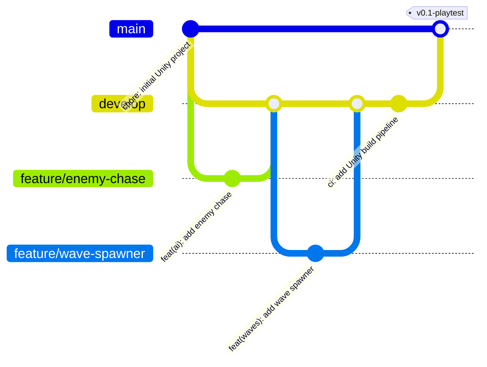

# Neon Outpost — Git Workflow

## Chosen Model: Feature Branching
We use Feature Branching with a `develop` integration branch. It is simple enough for a 4-person team, keeps `main` always stable, and gives every user story its own branch, which makes reviews small and easy.

## Branch Map

| Branch | Purpose | Created from | Merges into |
|---|---|---|---|
| `main` | Production-ready, playtest builds. **Protected.** | — | — |
| `develop` | Integration branch; all finished features land here. | `main` | `main` (at end of sprint) |
| `feature/*` | One branch per user story (e.g. `feature/enemy-chase`, `feature/wave-spawner`). | `develop` | `develop` |
| `hotfix/*` | Urgent fixes for a broken build on `main`. | `main` | `main` **and** `develop` |

## Diagram



## Merge Rules
1. **No direct pushes to `main` or `develop`.** All changes arrive through a Pull Request (PR).
2. **Approval:** at least **1 reviewer** must approve each PR. The author cannot approve their own PR. Scene or prefab changes must be reviewed by the person who owns that scene.
3. **Must pass before merge:** the CI build and EditMode tests must be green.
4. **Stay up to date:** before opening a PR, rebase the feature branch on the latest `develop`:
   ```bash
   git fetch origin
   git rebase origin/develop
   ```
5. **Merge strategy:** `--no-ff` so every feature shows up as its own merge commit in the history.
   ```bash
   git checkout develop
   git merge --no-ff feature/enemy-chase
   ```
6. **Clean up:** delete the feature branch after it is merged.
7. **Releases:** at the end of the sprint, `develop` is merged into `main` and tagged (e.g. `v0.1-playtest`).

## Commit Conventions (Conventional Commits)

| Prefix | Use for | Example |
|---|---|---|
| `feat:` | New gameplay feature | `feat(ai): add enemy chase behavior` |
| `fix:` | Bug fix | `fix(waves): stop double spawn on wave 3` |
| `chore:` | Setup, configs, housekeeping | `chore: initial Unity project` |
| `docs:` | Documentation | `docs: add sprint backlog` |
| `ci:` | Pipeline changes | `ci: add Unity build pipeline` |
| `test:` | Adding or fixing tests | `test: add wave count tests` |

## Unity-Specific Rules
- Use the Unity `.gitignore` so `Library/`, `Temp/`, `Logs/`, and `Builds/` are never committed.
- Set **Editor → Version Control → Visible Meta Files** and **Asset Serialization → Force Text** so scenes can be diffed.
- Large art files (PSD, audio, FBX) are tracked with **Git LFS**.
- Only one person edits a given scene at a time; others use prefabs.
